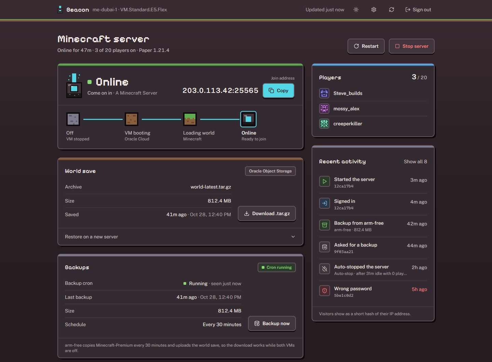
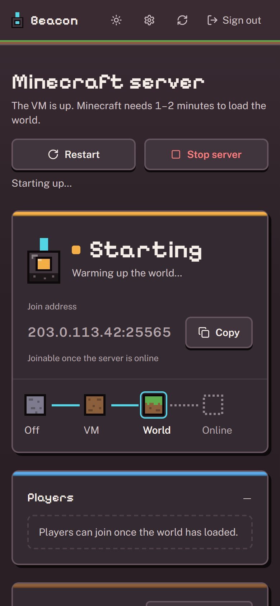

# Beacon

A small, private control panel for a friends-only Minecraft server running on an Oracle Cloud VM.
Anyone with the shared password can see whether the server is up, copy the join address, start or
stop the VM, and download the world save. It runs entirely on Cloudflare's free tier.





The screenshots use made-up data (a documentation IP address and invented player names).

## What it does

- **Status at a glance.** One answer to "can we play right now?": the server state, the join address
  with a copy button, and a four-step boot track (Off → VM booting → Loading world → Online), since
  Minecraft needs a minute or two after the VM is up.
- **Start, stop, restart** the Oracle VM. A 30-second cooldown stops double clicks, and stopping or
  restarting while people are online asks you to type `STOP` / `RESTART` first.
- **Players online**, from the public [mcsrvstat.us](https://mcsrvstat.us) API.
- **World save download**: from Oracle Object Storage a ready-to-play singleplayer `.zip` (extract it
  into `.minecraft/saves`), from Cloudflare R2 or straight from the VM a server `.tar.gz`. It works
  while the VM is off when the save lives in a bucket. See [World saves](#world-saves).
- **Backups from arm-free**: an always-on ARM VM copies the server every 30 minutes and uploads the
  save. The dashboard shows whether its cron job is alive and when the last backup ran, and has a
  **Backup now** button. See [Backups from arm-free](#backups-from-arm-free).
- **Oracle cost and trial tracking**: the VM's size, an estimated hourly cost, days left on the trial,
  and whether the VM would fit Oracle's Always Free Ampere allowance.
- **Activity log** of starts, stops, sign-ins and downloads (last 100 kept, IPs stored as a short hash).
- **Auto-stop** (optional worker): shuts the VM down after 30 minutes with nobody online.
- **Dark and light themes.** Follows the system setting until you pick one with the sun/moon button.
  **Settings** (the gear) turns the coloured strips on top of each card on or off. Both choices are
  remembered per browser.

## How it fits together

```
 Browser ──HTTPS──▶ Cloudflare Worker "beacon" (React app + Functions in functions/)
                        │  KV  DASH_KV: sessions, rate limits, cooldowns, activity log, caches
                        │  D1  DASH_DB: agent snapshot (≤1 write/min), "Backup now", events,
                        │               playtime, daily snapshot list, restore jobs
                        ├──▶ Oracle Cloud API (signed): VM state, power, public IP
                        ├──▶ mcsrvstat.us: public Minecraft status and players
                        ├──▶ Discord webhook (waitUntil, de-duplicated, ≤5 posts/min)
                        └──▶ Object Storage read link: world-latest.zip (download redirect)

 Worker "beacon-auto-stop" (cron, 10 min) ──▶ Oracle soft stop when idle; same KV + D1; Discord

 arm-free (always on, outbound HTTPS only)
   cron ─ mc-agent.sh poll (1 min) ──HTTPS + Bearer──▶ POST /api/agent/poll
   │        heartbeat + mc-probe.py status + snapshot list    ◀── { backup, restore: {id, snapshot} | null }
   │        └─ mc-probe.py ── private IP ──▶ Minecraft-Premium :25565 (status ping)
   │                                       ──▶ :25575 RCON (tps, mspt, list; arm-free only)
   │                                       ──▶ SSH: ps rss/etimes, MemTotal
   cron ─ mc-agent.sh scheduled (30 min), or a claimed "Backup now"   [flock ~/mc-backup/.lock]
   │        SSH tmux save-off/flush ─ ~/mc-backup.sh rsync pull ─ save-on
   │        pack-and-upload.sh ── PUT write link ──▶ Oracle Object Storage (world-latest.zip)
   └─ a claimed restore ─ mc-restore.sh                              [same lock]
            name checked against ~/mc-backup/daily ─ sudo -n systemctl stop minecraft (SSH)
            ─ current world → ~/mc-pre-restore/<time> ─ rsync snapshot in ─ Minecraft stays stopped
   every result ──▶ POST /api/agent/report

 Oracle VM (legacy) ── scripts/backup-world.sh ──▶ R2 / Object Storage / serve-backup.sh folder
```

- **Frontend:** React 18, Vite, Tailwind CSS, self-hosted Public Sans and Pixelify Sans (titles and the
  status word only; both SIL OFL, licences in `public/fonts/`). The pixel art (status beacon, boot-track
  blocks, player avatars) is inline SVG. No third-party scripts, fonts, images or CDNs. Colours and
  shapes are CSS variables in `src/index.css`, mapped into the Tailwind theme.
- **Backend:** Cloudflare Pages Functions (`functions/`), compiled into a Worker by `npm run build`
  and deployed with `wrangler.jsonc`. Web Crypto only: no Node APIs, no crypto packages.
- **Storage:** one KV namespace bound as `DASH_KV` (sessions, rate limits, cooldowns, activity log,
  caches); a D1 database bound as `DASH_DB` (the agent's per-minute snapshot, the "Backup now" request,
  events, playtime, snapshots, restore jobs; schema in `migrations/`); optionally an R2 bucket bound as
  `BACKUP_BUCKET`. The split exists because KV's free plan allows about 1,000 writes a day and D1's
  100,000: anything written every minute goes to D1.

## Quick start

You need Node 20+, a Cloudflare account and an Oracle Cloud VM running your Minecraft server.

```bash
npm install
cp .dev.vars.example .dev.vars        # then fill it in (see Configuration)
npm run hash-password "your-password" # paste the output into PASSWORD_HASH
npm run build
npx wrangler pages dev dist --kv DASH_KV
```

Open <http://localhost:8788> and sign in.

## Configuration

Set these in `.dev.vars` for local development, and as variables/secrets on the deployed Worker
(**Settings → Variables and Secrets** in the Cloudflare dashboard, or `npx wrangler secret put NAME`).

| Variable | Required | What it is |
|---|---|---|
| `OCI_TENANCY_OCID` | yes | Your Oracle Cloud tenancy OCID |
| `OCI_USER_OCID` | yes | The API user's OCID |
| `OCI_FINGERPRINT` | yes | Fingerprint of the API key you uploaded |
| `OCI_PRIVATE_KEY_B64` | yes | The PKCS#8 private key, base64-encoded (see [OCI API key](#oci-api-key)) |
| `OCI_REGION` | yes | Region of the VM, e.g. `me-dubai-1` |
| `OCI_INSTANCE_OCID` | yes | The Minecraft VM's OCID |
| `OCI_COMPARTMENT_OCID` | yes | Compartment holding the VM (used to find its public IP) |
| `PASSWORD_HASH` | yes | Output of `npm run hash-password` |
| `SESSION_SECRET` | yes | Random string of 32+ characters for signing session cookies |
| `TRIAL_END` | no | When the Oracle trial ends, ISO 8601 (`2026-12-01T00:00:00Z`). Leave out to hide the countdown |
| `BACKUP_URL` | no | Oracle Object Storage pre-authenticated request (or any HTTPS link) to the world save. Set it as a secret and use a **read-only** link: signed-in users are redirected to it |
| `AGENT_TOKEN` | no | Bearer token for arm-free's agent (`openssl rand -hex 32`, 32+ characters). Secret. Needs `DASH_DB` too |
| `VM_BACKUP_TOKEN` | no | Secret path segment for the direct-from-VM download |
| `TURNSTILE_SITEKEY` / `TURNSTILE_SECRET` | no | Cloudflare Turnstile bot check on the sign-in screen (set both) |
| `DISCORD_WEBHOOK_URL` | no | Discord webhook for alerts. **Secret**, on this Worker and on `workers/auto-stop`. Only `https://discord.com/api/webhooks/...` links are accepted |
| `DISCORD_EVENTS` | no | Which alerts to post: `all` (default), `none`, or a comma list of `server_starting`, `server_restarting`, `server_online`, `server_stopped`, `player_joined`, `player_left`, `backup_failed`, `restore_started`, `restore_finished` |
| `DISCORD_SHOW_ADDRESS` | no | `true` to put the join address in the "online" alert. Off by default |

| Binding | Required | What it is |
|---|---|---|
| `DASH_KV` | yes | KV namespace (already in `wrangler.jsonc`) |
| `DASH_DB` | for the agent | D1 database `beacon-agent` (already in `wrangler.jsonc`, `migrations_dir: migrations`). Also bound to `workers/auto-stop` |
| `BACKUP_BUCKET` | no | R2 bucket holding `world-latest.tar.gz` |

### Password hash

Beacon stores only a PBKDF2-SHA256 hash (100,000 iterations, random 16-byte salt):

```bash
npm run hash-password "your-strong-password"
# pbkdf2$100000$<salt>$<hash>
```

### OCI API key

Oracle signs API requests with an RSA key, and Web Crypto needs it in PKCS#8 form.

```bash
openssl genrsa -out oci_api_key.pem 2048
openssl pkcs8 -topk8 -inform PEM -outform PEM -nocrypt -in oci_api_key.pem -out oci_api_key_pkcs8.pem
openssl rsa -pubout -in oci_api_key.pem -out oci_api_key_public.pem
```

1. In the Oracle Cloud console, open **Profile → User settings → API keys → Add API key** and upload
   `oci_api_key_public.pem`. Note the fingerprint, user OCID and tenancy OCID it shows.
2. Base64-encode the PKCS#8 key into one line for `OCI_PRIVATE_KEY_B64`:

   ```bash
   base64 -w 0 oci_api_key_pkcs8.pem                                                  # Linux
   base64 -i oci_api_key_pkcs8.pem | tr -d '\n'                                       # macOS
   [Convert]::ToBase64String([IO.File]::ReadAllBytes("oci_api_key_pkcs8.pem"))        # PowerShell
   ```

The API user needs permission to read and power the instance and to read its VNIC, for example:

```
Allow group beacon to use instance-family in compartment <name>
Allow group beacon to read virtual-network-family in compartment <name>
```

## World saves

What the **Download** button gives you depends on the source. From Oracle Object Storage it is arm-free's
singleplayer zip, `world-<world>-<time>.zip` (see [What goes into the archive](#what-goes-into-the-archive)).
From R2 or the VM it is `backup-world.sh`'s `world-latest.tar.gz`: the world folder (with its nether and
end folders on Paper/Spigot), `server.properties`, `whitelist.json`, `ops.json`, the ban lists and
`usercache.json`. Beacon looks for a save in this order and uses the first that is configured:

| Source | Set up with | Works while the VM is off | How the download travels |
|---|---|---|---|
| **Cloudflare R2** (recommended) | `BACKUP_BUCKET` binding | yes | Streamed by Beacon over HTTPS, behind the sign-in |
| **Oracle Object Storage** | `BACKUP_URL` | yes | Redirect to the pre-authenticated HTTPS link |
| **Direct from the VM** | nothing (fallback) | no | Redirect to `http://<vm-ip>:8080/...` while `serve-backup.sh` runs |

The dashboard shows which source is in use, the archive's size and, next to the button, when it was
saved (for the zip, the world's own `level.dat` time). It only enables
the button when Beacon can see the file (the VM fallback cannot be checked from Cloudflare; see below).

### 1. Pack and upload from the VM

Copy `scripts/backup-world.sh` (and `serve-backup.sh` if you want the fallback) to the VM, then:

```bash
MC_DIR=/opt/minecraft bash backup-world.sh
```

The script:

1. Runs `save-off` and `save-all flush` in the `minecraft` screen or tmux session (if there is one),
   so the archive is consistent, and turns autosave back on afterwards, even if something fails.
2. Reads `level-name` from `server.properties`, packs whatever of the files above exist, skips logs
   and `session.lock`, and checks the archive with `gzip -t`.
3. Uploads it to every destination that is configured: an rclone remote named `r2`, the `UPLOAD_URL`
   link, and the local folder `serve-backup.sh` publishes.
4. Keeps dated copies in `OUT_DIR` for `KEEP_DAYS` days.

| Setting | Default | |
|---|---|---|
| `MC_DIR` | `/opt/minecraft` | Server folder |
| `MC_SESSION` | `minecraft` | screen/tmux session running the server |
| `OUT_DIR` | `/var/backups/minecraft` | Where archives are kept (must be writable) |
| `KEEP_DAYS` | `3` | Delete dated archives older than this |
| `R2_REMOTE` / `R2_BUCKET` | `r2` / `beacon-backups` | rclone remote and bucket |
| `UPLOAD_URL` | none | Object Storage pre-authenticated link with write access |
| `SERVE_DIR` | `$MC_DIR/.beacon-serve` | Folder `serve-backup.sh` publishes |
| `VM_BACKUP_TOKEN` | none | Secret folder name inside `SERVE_DIR` |

Run it on a schedule with cron. Remember the auto-stop worker turns the VM off when it is idle, so
pick a time when it is usually running, or run it by hand after a session:

```cron
0 4 * * * MC_DIR=/opt/minecraft bash /opt/beacon/backup-world.sh >> /var/log/mc-backup.log 2>&1
```

`scripts/vm-backup-to-r2.sh` still works as a name for existing crontabs; it runs `backup-world.sh`.

### 2a. Cloudflare R2 (recommended)

R2 has a free allowance of 10 GB with no egress fees, and the download stays behind Beacon's sign-in.

1. Create the bucket: `npx wrangler r2 bucket create beacon-backups`.
2. Bind it to Beacon: uncomment the `r2_buckets` block in `wrangler.jsonc` and deploy.
3. In **R2 → Manage API tokens**, create a token with *Object Read & Write* on that bucket.
4. On the VM, install rclone and add the remote:

   ```bash
   curl https://rclone.org/install.sh | sudo bash
   rclone config create r2 s3 provider=Cloudflare \
     access_key_id=<key-id> secret_access_key=<secret> \
     endpoint=https://<account-id>.r2.cloudflarestorage.com acl=private
   ```

5. Run `backup-world.sh`. The dashboard shows the save within seconds.

### 2b. Oracle Object Storage

1. Create a private bucket in the same region as the VM.
2. On the bucket, create a **pre-authenticated request** for the whole bucket. Give it a long expiry.
   Copy the URL; it ends in `/o/`.
3. Set that URL as `BACKUP_URL` in Beacon (Beacon appends `world-latest.zip`), and as `UPLOAD_URL`
   on the VM. A link that permits reads and writes works for both; for tighter access, give Beacon a
   read-only link and the VM a write-only one.

Beacon checks the link with a `HEAD` request (falling back to a 1-byte ranged `GET`) and caches the
answer for a minute, so a fresh upload can take up to a minute to appear.

### 2c. Direct from the VM (fallback)

With no bucket configured, Beacon can send you straight to the VM while it is running:

```bash
VM_BACKUP_TOKEN=<random-string> bash serve-backup.sh
```

This packs a fresh archive and serves **only** that folder on port 8080, never the server folder (it
holds the RCON password). For it to work:

- add an ingress rule for TCP 8080 to the VM's security list in the Oracle console;
- open the host firewall too on Oracle's Ubuntu images: `sudo iptables -I INPUT -p tcp --dport 8080 -j ACCEPT`;
- set the same `VM_BACKUP_TOKEN` in Beacon, so the link cannot be guessed.

Limits: Cloudflare cannot reach a bare IP, so Beacon cannot tell whether `serve-backup.sh` is
running; the download is plain HTTP, so browsers ask before keeping it; and it opens in a new tab so
a failure does not replace the dashboard. Use R2 or Object Storage when you can.

### 3. Restore on a new server

```bash
tar -xzf minecraft-world-*.tar.gz -C /opt/minecraft
```

Then start the server as usual. Moving to an Always Free Ampere (ARM) VM works the same way: world
files are not tied to the CPU.

## Backups from arm-free

Minecraft runs on the paid VM **Minecraft-Premium** (`10.0.0.16`), which auto-stop turns off when it
is idle. The free, always-on ARM VM **arm-free** (same subnet) copies it every 30 minutes with
`~/mc-backup.sh` (rsync into `~/mc-backup/latest`, daily snapshots in `~/mc-backup/daily`, the time of
each success in `~/mc-backup/.last_success`). Two scripts in `scripts/` connect that to Beacon:

- **`mc-agent.sh`** runs from cron. `poll` (every minute) sends a heartbeat and runs a backup when
  someone pressed **Backup now**; `scheduled` (every 30 minutes) is the regular backup and replaces
  calling `~/mc-backup.sh` from cron directly.
- **`pack-and-upload.sh`** turns the active world in `~/mc-backup/latest` into a singleplayer-ready
  `world-latest.zip` and uploads it to Oracle Object Storage, so the dashboard's **Download .zip**
  works while both VMs are off. It
  runs after every backup and skips the upload when nothing changed since the last one.

### How a backup flows

```
 Browser ── "Backup now" ──▶ POST /api/backup/request ──▶ D1: request = pending (one at a time, 5 min cooldown)
                                                              │
 arm-free, cron every minute: mc-agent.sh poll                │
   │ ── HTTPS, Bearer AGENT_TOKEN ──▶ POST /api/agent/poll ───┘  heartbeat saved; pending → running, once
   │ ◀─────────────────────── { "backup": true } ───────────────  (the only thing Beacon ever answers)
   │
   ├─ flock ~/mc-backup/.lock                        (scheduled runs take the same lock: no overlap)
   ├─ ssh ubuntu@10.0.0.16  tmux "mc": save-off, save-all flush, wait for "Saved the game" (≤30 s)
   ├─ ~/mc-backup.sh        rsync Minecraft-Premium → ~/mc-backup/latest
   ├─ ssh ubuntu@10.0.0.16  tmux "mc": save-on       (always, from a trap, even if the copy fails)
   ├─ pack-and-upload.sh    world-latest.zip ── PUT (write link) ──▶ Oracle Object Storage
   └─ POST /api/agent/report { ok, finishedAt, sizeBytes, error? } ──▶ D1: done / failed

 Browser ── Download ──▶ GET /api/backup?download=1 ── 302 to the read link ──▶ Oracle Object Storage
```

Beacon never connects to arm-free, and arm-free opens no ports: it only makes outbound HTTPS calls.
Beacon's answer to a poll is `{ "backup": true | false }` and nothing else, so it cannot be used to run
commands on arm-free.

The agent's state lives in D1 instead of KV. A heartbeat is a write every minute, and KV's free plan
allows 1,000 writes a day (Beacon already uses a share of that while the dashboard is open). D1 also
hands a request to the agent exactly once, where a KV write can take a minute to reach other locations.

### What the Backups panel shows

| | |
|---|---|
| **Cron running / Not responding** | Running while arm-free has polled in the last 3 minutes, with when it was last seen |
| **Last backup** | Time from `~/mc-backup/.last_success`, and the size of the uploaded archive. Turns amber, with a warning, when it is over 90 minutes old **while Minecraft-Premium is running**, counted from the later of the last backup and when the server came online. No warning while the VM is off |
| **Schedule** | Whether the 30-minute `mc-agent.sh scheduled` line is in arm-free's crontab and the cron service is active |
| **Backup now** | Requested → Running → Done (with size) or Failed (with a short reason). Disabled while one is pending or running, and for 5 minutes after each request. A request nobody picks up within 10 minutes, or that never reports back within an hour, shows as failed |

If Minecraft-Premium is off when you press **Backup now**, the run fails with "Minecraft-Premium is
off or unreachable" and the download keeps the last backup. Scheduled runs while it is off do nothing.

### What goes into the archive

A singleplayer world: extract the zip into `.minecraft/saves` and it is in the world list, with no
fixes by hand. The only top-level entry is the active world, the folder named by `level-name` in the
backed-up `server.properties` (`FINAL_FINAL_PAKKA_FINAL`); all three dimensions live inside it, under
`dimensions/minecraft/`. Nothing else from the server folder goes in. `~/mc-backup/latest` is never
written to. `pack-and-upload.sh`:

1. Stages a hardlink copy (`cp -al`) of the world in `~/mc-backup/.stage.*`, and drops `session.lock`.
2. Copies `dimensions/minecraft/overworld/data/minecraft/world_gen_settings.dat` to
   `data/minecraft/` in the world root: Paper keeps it only in the dimension folder, while vanilla and
   Fabric clients look for it in the root.
3. Checks for a non-empty `level.dat`, `data/minecraft/world_gen_settings.dat` and at least one `.mca`
   in `dimensions/minecraft/overworld/region`. If any is missing, nothing is uploaded, the download
   keeps the previous save, and the run fails with the missing items named, e.g. *World download not
   updated: FINAL_FINAL_PAKKA_FINAL is incomplete, missing world_gen_settings.dat*. The World save
   card and the Backups panel both show it.
4. Zips it with Python's `zipfile` (arm-free has no `zip`), tests every entry's CRC, and lists the zip
   to confirm the single top-level folder and `<world>/data/minecraft/world_gen_settings.dat`.

The object is always `world-latest.zip`, uploaded with
`Content-Disposition: attachment; filename="world-<world>-<level.dat time, UTC>.zip"`
(e.g. `world-FINAL_FINAL_PAKKA_FINAL-2026-10-29T19-30-12Z.zip`), so that is the name the browser
saves. Beacon reads the world name and time from the same header.

### Saving before the copy

The server runs in tmux session `mc` as `ubuntu` (started by `minecraft.service`). Before each copy
the agent runs one SSH command as `ubuntu` that sends `save-off` and `save-all flush`, then waits up to
30 seconds for `Saved the game` in `logs/latest.log`. After the copy it always sends `save-on`. If
`tmux has-session -t mc` fails (server not running) or SSH cannot connect (VM off), it skips this and
your two-pass rsync copies the files as they are. RCON is not used. To turn the step off, set
`MC_TMUX_SESSION=` (empty) in the env file.

If the agent is killed between `save-off` and `save-on`, the next backup (at most 30 minutes later)
sends `save-on` again. To do it by hand on Minecraft-Premium: `tmux send-keys -t mc save-on Enter`.

### Files on arm-free

| Path | |
|---|---|
| `~/beacon/mc-agent.sh`, `pack-and-upload.sh`, `mc-probe.py`, `mc-restore.sh` | The agent's scripts (`chmod 700`), all in one folder |
| `~/.config/beacon/agent.env` | `BEACON_URL`, `AGENT_TOKEN`, `UPLOAD_URL` (`chmod 600`; the scripts refuse to run otherwise). See `scripts/mc-agent-env.example` |
| `~/mc-backup/.lock` | flock shared by every backup |
| `~/mc-backup/upload/world-latest.zip` | The last archive built, plus `.uploaded_stamp`, the backup it came from |
| `~/mc-backup/agent.log` | What the agent did (trimmed past 1 MB). Polls only log problems |

The env file holds `KEY=value` lines and is parsed, never executed. The token and the upload link are
handed to curl through a file descriptor, so they never appear in `ps`, and the scripts never print
them.

| Setting | Default | |
|---|---|---|
| `BEACON_URL` | none | The dashboard's `https://` address |
| `AGENT_TOKEN` | none | Same value as Beacon's `AGENT_TOKEN` |
| `UPLOAD_URL` | none | Object Storage pre-authenticated request with write access, ending in `/o/` |
| `PREMIUM_SSH` | `ubuntu@10.0.0.16` | SSH target for the save-off / save-on step (a `~/.ssh/config` alias works) |
| `MC_TMUX_SESSION` | `mc` | tmux session running the server; empty skips the step |
| `MC_REMOTE_DIR` | `/home/ubuntu/minecraft` | Server folder on Minecraft-Premium (for `logs/latest.log`) |
| `BACKUP_ROOT` / `BACKUP_CMD` | `~/mc-backup` / `~/mc-backup.sh` | Your existing backup folder and script |
| `MC_HOST` / `MC_PORT` | `10.0.0.16` / `25565` | Where `mc-probe.py` pings Minecraft (the private IP, so it works without the public address) |
| `PRE_RESTORE_DIR` | `/home/ubuntu/mc-pre-restore` | Where a restore keeps the replaced world on Minecraft-Premium (last 2) |
| `RCON_PASSWORD` / `RCON_PORT` | none / `25575` | RCON for TPS, MSPT and the full player list (see [Set up RCON](#set-up-rcon-only-arm-free-may-reach-it)). Empty: no RCON |

### Set it up

1. **Object Storage** (Oracle console, Dubai region): create a private bucket, e.g. `beacon-saves`,
   with object versioning off so each upload replaces the last. On the bucket, create two
   **bucket-level pre-authenticated requests** with a long expiry and object listing off:
   - *Permit object reads*: Beacon's `BACKUP_URL`;
   - *Permit object writes*: arm-free's `UPLOAD_URL`.

   Both URLs end in `/o/`. One read+write link works for both, but Beacon redirects every download to
   `BACKUP_URL`, so anyone signed in could copy it from their browser and overwrite the save. The
   archive takes a few hundred MB of the 20 GB Always Free allowance.
2. **Beacon:** create the database and the token, then deploy:

   ```bash
   npx wrangler d1 create beacon-agent      # put the id in the d1_databases blocks (binding DASH_DB) of wrangler.jsonc and workers/auto-stop/wrangler.toml
   npx wrangler d1 migrations apply beacon-agent --remote   # creates or updates the tables; run again after pulling new migrations
   openssl rand -hex 32                     # the token: for the next command and the env file
   npx wrangler secret put AGENT_TOKEN
   npx wrangler secret put BACKUP_URL       # the read link
   npm run build && npx wrangler deploy
   ```
3. **arm-free:** install cron and curl (Ubuntu Minimal ships without cron), copy the scripts over and
   write the env file:

   ```bash
   sudo apt-get update && sudo apt-get install -y cron curl
   sudo systemctl enable --now cron
   mkdir -p ~/beacon ~/.config/beacon
   # from your PC: scp scripts/mc-agent.sh scripts/pack-and-upload.sh scripts/mc-probe.py scripts/mc-restore.sh ubuntu@<arm-free-public-ip>:beacon/
   chmod 700 ~/beacon/*.sh ~/beacon/*.py
   (umask 077 && nano ~/.config/beacon/agent.env)   # BEACON_URL, AGENT_TOKEN, UPLOAD_URL
   chmod 600 ~/.config/beacon/agent.env
   ```
4. **Cron on arm-free** (`crontab -e`): replace the line that runs `~/mc-backup.sh` with these two, so
   every backup goes through the shared lock:

   ```cron
   * * * * * /home/ubuntu/beacon/mc-agent.sh poll
   */30 * * * * /home/ubuntu/beacon/mc-agent.sh scheduled
   ```

Run either by hand to watch it (`~/beacon/mc-agent.sh poll` prints to the terminal instead of the
log), and `~/beacon/pack-and-upload.sh --force` to upload the current copy straight away.

## Playtime and last seen

Every minute `mc-agent.sh` runs `scripts/mc-probe.py ping`, a Minecraft server-list ping to
Minecraft-Premium's private IP (`MC_HOST`, port `MC_PORT`; Python 3 standard library, no pip), and
sends who is online with its heartbeat. Beacon compares that list with the sessions open in D1:

- **A new name** opens a session (and posts "joined"). **A missing name** closes it at the last poll
  that actually saw the player (and posts "left" with the session length). D1 is written only then.
- **Playtime is never inflated.** If arm-free stops reporting, or Minecraft stops answering, open
  sessions end at their last sighting; nothing is counted for the silence, and nothing is announced
  across a gap of more than 3 minutes. While the server is down, players are not reported as leaving
  one by one: the "Server stopped" alert covers it.
- **Names are labels, not identities.** The server runs in offline mode, so anyone can use any name.
  Players are keyed by the lowercase name and shown with the latest casing; names are always rendered
  as text on the page and escaped in Discord.
- **The list must be complete.** The ping only carries a sample of names (Paper sends up to 12), and
  players who turned off "Allow Server Listings" show as anonymous. When the names do not add up to
  the player count the agent reports the list as unknown and Beacon changes nothing. With RCON set up
  (see [Server health](#server-health)) the agent uses `list`, which has every name.

The **Leaderboard** card shows the top 10 by playtime with sessions, an "Online now" badge while the
last sighting is under 3 minutes old, and "last seen" otherwise. To start counting from zero:

```bash
npx wrangler d1 execute beacon-agent --remote --command "DELETE FROM players"
```

## Server health

The **Server health** card shows ticks per second (TPS) with a band and a word, **Good** (19 and up),
**Strained** (15 to 19) or **Lagging** (under 15); the tick time (MSPT); Minecraft's memory against the
VM's total; how long Minecraft has been running; and how old the reading is. It greys out when the
reading is more than 3 minutes old and says so when Minecraft is not answering.

Every minute `mc-probe.py status` (called by `mc-agent.sh`) collects:

| Value | From | Needs |
|---|---|---|
| Online, players, version | Server-list ping to `MC_HOST:MC_PORT` | nothing |
| TPS, MSPT, every player name | RCON `tps`, `mspt`, `list` (colour codes stripped, parsed defensively; anything unreadable shows as "unavailable") | RCON, below |
| Memory, uptime, VM memory | One fixed command over the existing SSH key: `ps -C java -o rss=,etimes=` and `MemTotal` from `/proc/meminfo`. Runs only when Minecraft answered | nothing new |

### Set up RCON (only arm-free may reach it)

RCON lets whoever has its password run any server command, so it must only be reachable from
arm-free. On Minecraft-Premium it is currently off (`enable-rcon=false`, `rcon.port=25575`). Check
before you change anything:

```bash
# On Minecraft-Premium (never print rcon.password)
grep -E '^(enable-rcon|rcon\.port|broadcast-rcon-to-ops)=' /home/ubuntu/minecraft/server.properties
sudo iptables -S INPUT | grep -E '25575|ACCEPT' ; sudo ss -ltnp | grep 25575
# On arm-free: its private IP, for the rules below
hostname -I
```

1. **Password, on arm-free.** `openssl rand -hex 24`, then add `RCON_PASSWORD=<it>` to
   `~/.config/beacon/agent.env` (still `chmod 600`). It never goes anywhere else on arm-free, never on a
   command line, and Beacon never sees it.
2. **server.properties, on Minecraft-Premium.** Set
   `enable-rcon=true`, `rcon.port=25575`, `rcon.password=<the same>` and
   `broadcast-rcon-to-ops=false` (otherwise ops see every per-minute `tps` in chat). arm-free's zip
   holds only the world folder; `backup-world.sh`'s archive carries `server.properties` with
   `rcon.password` blanked.
3. **OCI security list** of the subnet (Networking → Virtual cloud networks → your VCN → Security
   Lists, or the NSG on Minecraft-Premium's VNIC if you use one): add an ingress rule, stateful,
   source `<arm-free private IP>/32`, TCP, destination port `25575`. Make sure no other rule already
   opens 25575 (or all ports) to `0.0.0.0/0`.
4. **iptables on Minecraft-Premium** (Oracle's Ubuntu images reject everything not allowed):

   ```bash
   sudo iptables -I INPUT -p tcp -s <arm-free private IP> --dport 25575 -j ACCEPT
   sudo netfilter-persistent save
   ```

5. Restart Minecraft (`sudo systemctl restart minecraft`, or Restart in Beacon), then test from arm-free
   without putting the password on the command line:

   ```bash
   RCON_PASSWORD="$(grep '^RCON_PASSWORD=' ~/.config/beacon/agent.env | cut -d= -f2-)" \
     python3 ~/beacon/mc-probe.py status --host 10.0.0.16 --ssh ubuntu@10.0.0.16
   ```

   and from anywhere else (your PC) that the port is closed:
   `Test-NetConnection <premium public IP> -Port 25575` must say `TcpTestSucceeded : False`.

## Backup history and restore points

`mc-agent.sh` reports the files in `~/mc-backup/daily` (name, size, time; newest 60) with each
heartbeat, and the **Backups** panel lists them under **Restore points**. **Restore** replaces the
active world on Minecraft-Premium with the one from a snapshot, after you type `RESTORE`.

Beacon refuses a restore unless all of these hold, checked on the server when you ask:

- the snapshot is in arm-free's latest list, and arm-free is responding;
- Minecraft-Premium is running (the world is copied onto it) and nobody is online, according to both
  arm-free's probe and mcsrvstat;
- no backup is running and no other restore is pending or running.

While a restore is active, Start / Stop / Restart are refused and the auto-stop worker leaves the VM
alone. The request, the result and both Discord alerts go to the activity log.

What arm-free does (`scripts/mc-restore.sh`, fixed steps, under the same lock as every backup):

1. Accepts the file name only if it is exactly the name of a file in `~/mc-backup/daily`; nothing in
   it is ever run. Reads `level-name` from Minecraft-Premium's `server.properties`.
2. Probes the server once more and stops if anyone has joined; extracts only `<level>`,
   `<level>_nether` and `<level>_the_end` from the snapshot. Plugins and config are never touched.
3. Stops Minecraft with `sudo -n /usr/bin/systemctl stop minecraft` (the service's own `ExecStop`
   saves and quits), then waits until no java process and no tmux session `mc` remain.
4. Moves the current three folders to `~/mc-pre-restore/<time>/` on Minecraft-Premium, outside the
   server folder so backups do not copy them, and keeps the last 2.
5. `rsync`s the snapshot's folders into place; if that fails, the previous world is moved back.
6. Leaves Minecraft stopped and reports. Use **Restart** in Beacon when you want it back (the VM
   reboots and `minecraft.service` starts with it).

A request nobody picks up within 10 minutes, or a restore with no result after 90 minutes, shows as
failed. To try a restore without changing anything: `~/beacon/mc-restore.sh --check <file name>`.

### Let the agent stop Minecraft (sudoers drop-in)

The restore needs `ubuntu` on Minecraft-Premium to stop the service without a password, and nothing
more. `scripts/beacon-minecraft.sudoers` allows exactly `systemctl stop minecraft` and
`systemctl start minecraft`. Check how sudo works there today, then install it through `visudo`:

```bash
sudo -l                                            # Oracle images usually allow ubuntu everything already
scp scripts/beacon-minecraft.sudoers ubuntu@<premium>:/tmp/beacon-minecraft   # from your PC (via arm-free)
sudo visudo -cf /tmp/beacon-minecraft              # must print "parsed OK"
sudo install -m 0440 -o root -g root /tmp/beacon-minecraft /etc/sudoers.d/beacon-minecraft
sudo -l | grep minecraft
```

## Discord alerts

Set `DISCORD_WEBHOOK_URL` (in Discord: channel **Settings → Integrations → Webhooks → New Webhook →
Copy Webhook URL**) as a secret on both Workers, and Beacon posts:

| Alert | Posted by | When |
|---|---|---|
| 🟡 Server starting / restarting | dashboard | Start or Restart pressed ("from the dashboard": there is one shared password, so no names) |
| 🟢 Server is online | agent | arm-free's probe gets an answer from Minecraft after it was down |
| ➕ / ➖ Player joined / left | agent | A name appears in or disappears from the online list (see [Playtime and last seen](#playtime-and-last-seen)) |
| 🔴 Server stopped | dashboard, auto-stop, agent | Stop pressed, idle auto-stop, or Minecraft stopped answering, with the reason |
| ⚠️ Backup failed | agent | Every failed "Backup now"; failed scheduled backups at most once every 3 hours |
| ♻️ / ✅ Restore started / finished | dashboard, agent | See [Backup history and restore points](#backup-history-and-restore-points) |

How it stays quiet and safe:

- **One post per event.** Every event is a row in D1 with a key; an event whose key already appeared
  within a few minutes is skipped, in one atomic statement. A stop pressed in the dashboard and then
  noticed by the agent a minute later is posted once.
- **No storms.** Events from one request go out as one message, at most 5 posts a minute across all
  sources. A post Discord rejects (429 included) is dropped and recorded, never retried.
- **Never in the way.** Posting runs in `waitUntil` after the response, so a slow Discord never slows
  the agent's poll or a power action.
- **Untrusted names.** The server runs in offline mode, so a player name can be anything. Names are
  stripped of control, zero-width and bidi characters, cut to 32 characters, Discord markdown is
  escaped, and every post sets `allowed_mentions: {"parse": []}` so `@everyone` in a name pings nobody.
- **Nothing private.** Messages carry no IP hashes and no tokens. The join address only appears with
  `DISCORD_SHOW_ADDRESS=true`. The webhook URL is never logged.

Every event is also kept in D1 for 60 days with how its post went (`sent`, `failed`, `limited`, `off`):

```bash
npx wrangler d1 execute beacon-agent --remote --command "SELECT type, source, discord, datetime(created_at/1000,'unixepoch') FROM events ORDER BY id DESC LIMIT 20"
```

## Local development

```bash
npm run build
npx wrangler pages dev dist --kv DASH_KV                                   # http://localhost:8788
npx wrangler pages dev dist --kv DASH_KV --r2 BACKUP_BUCKET=beacon-backups # with a local R2 bucket
```

With a local D1 database (the id is the one in `wrangler.jsonc`; both commands must share `--persist-to`):

```bash
npx wrangler d1 migrations apply beacon-agent --local --persist-to .wrangler/state
npx wrangler pages dev dist --kv DASH_KV --d1 DASH_DB=eabc4e41-2f5a-4c05-830a-4b3e8bb53713 --persist-to .wrangler/state
```

With `AGENT_TOKEN` in `.dev.vars`, you can play the agent with curl:

```bash
curl -s -X POST http://localhost:8788/api/agent/poll -H "Authorization: Bearer $AGENT_TOKEN" \
  -H 'Content-Type: application/json' -d '{"lastSuccess":"2026-10-28T10:00:00Z","busy":false}'
```

To put a test archive in the local bucket:

```bash
npx wrangler r2 object put beacon-backups/world-latest.tar.gz --file ./world-latest.tar.gz --local
```

For hot reload of the UI, keep `wrangler pages dev` running and start Vite alongside it with
`npm run dev`; Vite proxies `/api` to port 8788.

## Deployment

`wrangler.jsonc` deploys Beacon as a Worker that serves the built app from `dist/` and runs the
Functions compiled by `npm run build`:

```bash
npm run build
npx wrangler deploy
```

Add the variables from [Configuration](#configuration) under **Settings → Variables and Secrets**
(the private key, password hash and session secret as secrets). `keep_vars` in `wrangler.jsonc` keeps
dashboard variables across deploys. The KV namespace and the `DASH_DB` database are already bound;
R2 is bound by the commented block in `wrangler.jsonc`.

### Auto-stop worker

`workers/auto-stop` checks every 10 minutes and sends a graceful stop once the server has had nobody
online for `AUTO_STOP_MINUTES` (default 30). It shares the dashboard's KV namespace, so its stops
appear in the activity log.

```bash
cd workers/auto-stop
npx wrangler secret put OCI_TENANCY_OCID     # and OCI_USER_OCID, OCI_FINGERPRINT,
                                             # OCI_PRIVATE_KEY_B64, OCI_INSTANCE_OCID, OCI_COMPARTMENT_OCID
npx wrangler secret put DISCORD_WEBHOOK_URL  # optional: the same webhook as the dashboard
npx wrangler deploy
```

Set `OCI_REGION`, `AUTO_STOP_MINUTES` and (optionally) `DISCORD_EVENTS` in
`workers/auto-stop/wrangler.toml`. It shares the dashboard's D1 database (`DASH_DB`) to record its
stop event and de-duplicate it with the dashboard's.

## Security

- **Restores** need a session, the CSRF checks and a typed `RESTORE`, and are refused while anyone is
  online, while a backup runs, or while another restore is active. Beacon sends arm-free only a job
  id and a file name; arm-free accepts the name only if it matches a file it has and runs a fixed
  script. Power actions and auto-stop are blocked while a restore runs. On Minecraft-Premium, sudo
  is needed only for `systemctl stop|start minecraft` (`scripts/beacon-minecraft.sudoers`).
- **RCON** is reachable from arm-free's private IP only (OCI ingress rule plus iptables), its password
  lives only in arm-free's `chmod 600` env file and `server.properties`. arm-free's zip leaves
  `server.properties` out, and `backup-world.sh`'s archive carries it with `rcon.password` blanked.
- **Discord** messages carry no IP hashes or tokens; player names are escaped and mentions disabled.
  The webhook URL is a Worker secret and is never logged.
- **Agent data** is validated strictly: unknown fields, wrong types and oversized lists are rejected.

- **One shared password**, stored as a PBKDF2-SHA256 hash and checked in constant time.
- **Sessions** are HMAC-signed `__Host-` cookies: `HttpOnly`, `Secure`, `SameSite=Strict`, 8 hours.
- **Brute force:** 5 wrong passwords lock that IP for 15 minutes; 25 across all IPs lock sign-in for
  everyone for 15 minutes. Each failure waits 800 ms. Optional Turnstile on top.
- **CSRF:** every `POST` must come from the same origin with an `X-Requested-With` header and a JSON
  body under 1 KB.
- **Strict CSP:** scripts, styles, fonts and connections from the app's own origin only (plus
  Cloudflare's challenge domain when Turnstile is on).
- **Power actions** are re-checked on the server: valid state, cooldown, and players online.
- **World saves** from R2 are only served to signed-in users. Object Storage and VM links are secrets:
  anyone who has the full URL can download the save. Give Beacon a read-only link, since signed-in
  users see it in the redirect, and keep the write link on arm-free only.
- **Agent routes** (`/api/agent/poll`, `/api/agent/report`) are the only routes without the session
  cookie and CSRF checks. They need `Authorization: Bearer <AGENT_TOKEN>` (compared in constant time
  over SHA-256 digests), accept only `POST` with a JSON body under 1 KB (enforced while reading, even
  without `Content-Length`), and allow 10 calls a minute each. 10 wrong tokens lock an IP out for
  15 minutes. Any other `/api/agent/...` path still needs a session. Poll answers only
  `{ "backup": true | false }`; reported fields are type-checked, and error text is cut to one line of
  200 characters before it reaches the dashboard.
- **Backup now** is a normal dashboard action: session, CSRF, one request at a time, one every
  5 minutes, written to the activity log. It only sets a flag; arm-free decides what to run.

## API

| Route | Auth | |
|---|---|---|
| `POST /api/login` | public | `{ password, turnstileToken? }` → sets the session cookie |
| `GET /api/config` | public | `{ turnstileSiteKey }` for the sign-in screen |
| `GET /api/session` | session | 200 if the cookie is valid, 401 if not |
| `GET /api/status` | session | VM and Minecraft state, players, address, usage, trial, world save, activity, `backupJob` (heartbeat, last backup, request state, cooldown, overdue) and `leaderboard` (top 10 by playtime) and `health` (TPS, MSPT, memory, uptime, age of the reading) |
| `POST /api/power` | session | `{ action: "start" \| "stop" \| "restart", force? }`; 409 with `playerCount` if people are online |
| `GET /api/backup` | session | Where the world save is and whether it can be downloaded |
| `GET /api/backup?download=1` | session | The download (stream from R2, or a redirect) |
| `POST /api/backup/request` | session | "Backup now": `{}` → `{ state: "pending" }`; 409 if one is pending or running, 429 with `retryAfter` during the 5-minute cooldown |
| `POST /api/restore/request` | session | `{ snapshot, confirm: "RESTORE" }` → `{ id, state: "pending" }`; 409 with the reason when a restore is not possible right now |
| `POST /api/agent/poll` | agent token | Heartbeat `{ lastSuccess?, archiveBytes?, busy?, cronActive?, scheduleInstalled?, minecraft?, health?, snapshots? }`, validated strictly (unknown fields rejected, 8 KB) → `{ backup: true \| false, restore: { id, snapshot } \| null }` |
| `POST /api/agent/report` | agent token | Backup: `{ trigger, ok, finishedAt, sizeBytes?, error? }`; restore: `{ kind: "restore", restoreId, ok, finishedAt, error? }` → `{ recorded }` |
| `POST /api/logout` | session | Clears the cookie |

## Project layout

```
functions/            Cloudflare Functions (API + middleware)
  _lib/               auth, OCI request signing, Minecraft status, rate limits, activity log, backups
  api/                one file per route
src/                  React app
  components/         screens and panels
  serverState.ts      VM + Minecraft state → what the screen says
scripts/              hash-password, backup-world.sh, serve-backup.sh,
                      arm-free: mc-agent.sh, pack-and-upload.sh, mc-probe.py, mc-restore.sh
                      Minecraft-Premium: beacon-minecraft.sudoers
migrations/           D1 schema (npx wrangler d1 migrations apply beacon-agent --remote)
workers/auto-stop/    idle shutdown cron worker
public/               fonts (Public Sans, OFL), favicon, security headers
```

## Troubleshooting

- **State shows "Unknown"**: Beacon could not read the VM from Oracle. Check the `OCI_*` values,
  that the key is PKCS#8, and the API user's permissions.
- **Stuck on "Loading world"**: the VM is up but mcsrvstat.us cannot reach Minecraft. Check that the
  server is running and TCP 25565 is open in the security list and the host firewall.
- **The download button is off**: read the line under it. "Waiting for upload" means the bucket is
  connected but `backup-world.sh` has not uploaded yet; "Not set up" means no source is configured
  and the VM is off.
- **The VM download fails or never finishes**: `serve-backup.sh` is not running, or port 8080 is
  closed in the security list or by iptables.
- **Signed out after deploying**: changing `SESSION_SECRET` invalidates existing sessions.
- **Backups says "Not responding"**: arm-free has not polled for 3 minutes. On arm-free, check
  `systemctl is-active cron`, `crontab -l` and `tail ~/mc-backup/agent.log`. "Poll failed" there means
  a wrong `BEACON_URL` or a token that does not match Beacon's `AGENT_TOKEN`.
- **"Backup now" stays on Requested**: same as above; the agent picks requests up only when it polls.
- **Schedule says "Not in crontab"**: the `*/30 ... mc-agent.sh scheduled` line is missing, so only
  "Backup now" makes backups.
- **The flush is always skipped**: from arm-free, while the server is up, run
  `ssh ubuntu@10.0.0.16 tmux has-session -t mc`. It must succeed without a password prompt.
